# kubevirt-tenants

Prepares a KubeVirt (hosting workload) cluster for the CAPK workload clusters it runs. Deployed by the
`kubevirt-tenants` unit of sylva-units, from `kubevirt_tenants`.

For each tenant, that is for each CAPK cluster hosted here, a namespace holding the VMs of that cluster:

| Resource | Purpose |
|---|---|
| Namespace (privileged) | holds the tenant VMs (virt-launcher pods) |
| ServiceAccount `capk-tenant` + token Secret, Role, PV reader ClusterRoleBinding | scoped credentials used by CAPK, the KubeVirt CSI driver and CCM of the tenant clusters, and by the tenant owner (`virtctl ssh`) |
| Secret `capk-tenant-api` | the API server URL of this cluster (`https://<api_server_address>:6443`), which with the token Secret is all a tenant kubeconfig needs |
| ResourceQuota (optional) | caps the tenant resources |
| NetworkPolicies | isolate the tenant VMs from the hosting pod network and other tenants |
| MetalLB IPAddressPool + L2Advertisement (MetalLB only) | serve the tenant `addresses`, for the tenant namespace only |
| ValidatingAdmissionPolicy | confines the Services of the tenant namespace to the tenant `addresses`, without NodePorts |
| ValidatingAdmissionPolicy (VMs) | denies tenant VMs with tolerations or priority classes (beyond `allowed_priority_classes`), and migrations that set more than the VMI name |
| MutatingAdmissionPolicy (Kubernetes 1.36 or later) | sets `allocateLoadBalancerNodePorts: false` on the tenant LoadBalancer Services (MetalLB and kube-vip don't need NodePorts) |

## How the kubeconfig of a tenant cluster is built

The cluster of a tenant needs a kubeconfig of the hosting workload cluster, with the `capk-tenant` credentials: CAPK uses it to create the VMs, the KubeVirt CCM and CSI driver to create Services and disks. It is built in the management cluster with ESO: none is made or copied by hand, and none can be given.

Three clusters are involved:

- the **management cluster**, where CAPK and External Secrets run;
- the **hosting workload cluster**, a workload cluster of that management cluster, which runs KubeVirt and the VMs;
- the **tenant cluster**, the CAPK cluster whose nodes are these VMs: another workload cluster of that  management cluster.

The sylva-units of the hosting workload cluster and of the tenant cluster both run in the management cluster,
each in the namespace of its cluster.

The same chart is released twice from the `kubevirt_tenants` of the hosting workload cluster, by two units of
its sylva-units (which runs in the management cluster): **release ①** (green) is applied *remotely* to the hosting
workload cluster, **release ②** (blue) *locally* in the management cluster. The unit ③ (orange) belongs to the
tenant cluster and does not use this chart.

A tenant serves exactly **one** CAPK cluster, and has two namespaces:

- its namespace in the **hosting workload cluster** (`namespace`, default: the tenant name), holding the VMs. The
  owner of the hosting workload cluster chooses it, and it never changes: a namespace cannot be renamed, and deleting
  it deletes the VMs;
- the namespace of its CAPK cluster in the **management cluster** (`management_namespace`, default: the tenant
  namespace), where the sylva-units of that cluster runs. It is set by the way the cluster is deployed (see
  [Tenant clusters declared with a SylvaWorkloadCluster](#tenant-clusters-declared-with-a-sylvaworkloadcluster)), and
  it is the only namespace that can use the tenant credentials.

A management cluster namespace holds a single workload cluster (sylva-units names its objects after its units), so
a tenant serves a single CAPK cluster. Several clusters, for example the dev and prod clusters of a team, are several
tenants: each has its own credentials, quota and NetworkPolicies, so a cluster cannot reach or manage the VMs of
another one (the tenant kubeconfig is copied into the tenant cluster, for its CCM and CSI driver).

In this example, the hosting workload cluster is `wkld-cluster-hosting-kubevirt` and its tenant `tenant-a`, for the
CAPK cluster `cluster-a` of the SylvaWorkloadCluster `cluster-a` of the workload team `team-a`, whose sylva-units runs
in the management cluster namespace `swct-team-a--cluster-a`. Colors show who creates each object:

```mermaid
flowchart LR
  subgraph mgmt["Management cluster"]
    direction TB
    subgraph mhns["namespace wkld-cluster-hosting-kubevirt"]
      direction TB
      su1["sylva-units of the hosting workload cluster<br/><code>kubevirt_tenants:#nbsp;#nbsp;#nbsp;#nbsp;#nbsp;#nbsp;#nbsp;#nbsp;#nbsp;#nbsp;#nbsp;#nbsp;#nbsp;#nbsp;#nbsp;#nbsp;#nbsp;#nbsp;#nbsp;#nbsp;#nbsp;#nbsp;#nbsp;#nbsp;#nbsp;#nbsp;#nbsp;#nbsp;#nbsp;#nbsp;#nbsp;</code><br/><code>#nbsp;#nbsp;tenant-a:#nbsp;#nbsp;#nbsp;#nbsp;#nbsp;#nbsp;#nbsp;#nbsp;#nbsp;#nbsp;#nbsp;#nbsp;#nbsp;#nbsp;#nbsp;#nbsp;#nbsp;#nbsp;#nbsp;#nbsp;#nbsp;#nbsp;#nbsp;#nbsp;#nbsp;#nbsp;#nbsp;#nbsp;#nbsp;#nbsp;#nbsp;#nbsp;#nbsp;#nbsp;#nbsp;#nbsp;#nbsp;</code><br/><code>#nbsp;#nbsp;#nbsp;#nbsp;management_namespace:#nbsp;swct-team-a--cluster-a</code><br/><code>#nbsp;#nbsp;#nbsp;#nbsp;addresses:#nbsp;[...]#nbsp;#nbsp;#nbsp;#nbsp;#nbsp;#nbsp;#nbsp;#nbsp;#nbsp;#nbsp;#nbsp;#nbsp;#nbsp;#nbsp;#nbsp;#nbsp;#nbsp;#nbsp;#nbsp;#nbsp;#nbsp;#nbsp;#nbsp;#nbsp;#nbsp;#nbsp;#nbsp;#nbsp;</code>"]
      rel1["① HelmRelease <b>kubevirt-tenants</b><br/>values: <code>tenants</code><br/>kubeConfig: the hosting workload cluster"]
      rel2["② HelmRelease <b>kubevirt-tenants-credentials</b><br/>values: <code>credentials_stores</code><br/>no kubeConfig: this cluster"]
    end
    store["ClusterSecretStore<br/><b>capk.wkld-cluster-hosting-kubevirt.swct-team-a--cluster-a</b><br/>connects with Secret wkld-cluster-hosting-kubevirt-kubeconfig<br/>reads only namespace tenant-a of wkld-cluster-hosting-kubevirt<br/>usable only from namespace swct-team-a--cluster-a"]
    subgraph mtns["namespace swct-team-a--cluster-a"]
      direction TB
      su2["sylva-units of the tenant cluster<br/><code>cluster:#nbsp;#nbsp;#nbsp;#nbsp;#nbsp;#nbsp;#nbsp;#nbsp;#nbsp;#nbsp;#nbsp;#nbsp;#nbsp;#nbsp;#nbsp;#nbsp;#nbsp;#nbsp;#nbsp;#nbsp;#nbsp;#nbsp;#nbsp;#nbsp;#nbsp;#nbsp;#nbsp;#nbsp;#nbsp;#nbsp;#nbsp;#nbsp;#nbsp;#nbsp;#nbsp;#nbsp;#nbsp;#nbsp;#nbsp;#nbsp;#nbsp;#nbsp;</code><br/><code>#nbsp;#nbsp;name:#nbsp;cluster-a#nbsp;#nbsp;#nbsp;#nbsp;#nbsp;#nbsp;#nbsp;#nbsp;#nbsp;#nbsp;#nbsp;#nbsp;#nbsp;#nbsp;#nbsp;#nbsp;#nbsp;#nbsp;#nbsp;#nbsp;#nbsp;#nbsp;#nbsp;#nbsp;#nbsp;#nbsp;#nbsp;#nbsp;#nbsp;#nbsp;#nbsp;#nbsp;#nbsp;</code><br/><code>#nbsp;#nbsp;capk:#nbsp;#nbsp;#nbsp;#nbsp;#nbsp;#nbsp;#nbsp;#nbsp;#nbsp;#nbsp;#nbsp;#nbsp;#nbsp;#nbsp;#nbsp;#nbsp;#nbsp;#nbsp;#nbsp;#nbsp;#nbsp;#nbsp;#nbsp;#nbsp;#nbsp;#nbsp;#nbsp;#nbsp;#nbsp;#nbsp;#nbsp;#nbsp;#nbsp;#nbsp;#nbsp;#nbsp;#nbsp;#nbsp;#nbsp;#nbsp;#nbsp;#nbsp;#nbsp;</code><br/><code>#nbsp;#nbsp;#nbsp;#nbsp;hosting_cluster:#nbsp;wkld-cluster-hosting-kubevirt</code>"]
      es["③ ExternalSecret<br/>cluster-a-capk-infra"]
      infra["Secret <b>cluster-a-capk-infra</b><br/>the tenant kubeconfig"]
    end
  end

  subgraph hosting["Hosting workload cluster"]
    subgraph hns["namespace tenant-a"]
      direction TB
      rbac["ServiceAccount capk-tenant + Role<br/>NetworkPolicies, quota, admission policies"]
      secrets["Secrets capk-tenant-token (filled by Kubernetes)<br/>and capk-tenant-api (API server URL)"]
      vms["VMs, disks, Services<br/>of the tenant cluster"]
    end
  end

  subgraph tenant["Tenant cluster"]
    ccm["kubevirt-ccm<br/>kubevirt-csi-driver"]
  end

  su1 == "① kubevirt-tenants unit" ==> rel1
  su1 == "② kubevirt-tenants-credentials unit" ==> rel2
  rel1 == "creates" ==> rbac
  rel1 == "creates" ==> secrets
  rel2 == "creates" ==> store
  su2 == "③ capk-hosting-credentials unit" ==> es
  es -- "refers to" --> store
  store -. "External Secrets reads" .-> secrets
  es -- "External Secrets writes" --> infra
  infra -- "CAPK creates" --> vms
  infra -- "copied by the tenant units" --> ccm
  ccm -- "create Services and disks" --> vms

  classDef rel1 fill:#d1fae5,stroke:#059669,stroke-width:2px,color:#064e3b
  classDef rel2 fill:#dbeafe,stroke:#2563eb,stroke-width:2px,color:#1e3a8a
  classDef tenantUnit fill:#ffedd5,stroke:#ea580c,stroke-width:2px,color:#7c2d12
  classDef eso fill:#ede9fe,stroke:#7c3aed,stroke-width:2px,color:#3b0764
  classDef other fill:#f3f4f6,stroke:#6b7280,stroke-dasharray:4 3,color:#111827
  class rel1,rbac,secrets rel1
  class rel2,store rel2
  class es tenantUnit
  class infra eso
  class su1,su2,vms,ccm other
```



| Color | Created by |
|---|---|
| 🟩 green | release ① of this chart (`kubevirt-tenants` unit), in the hosting workload cluster |
| 🟦 blue | release ② of this chart (`kubevirt-tenants-credentials` unit), in the management cluster |
| 🟧 orange | the `capk-hosting-credentials` unit of the tenant cluster |
| 🟪 purple | External Secrets, from the ExternalSecret ③ and the ClusterSecretStore ② |
| ⬜ grey, dashed | other components (sylva-units, CAPK, the tenant cluster units) |

Thick arrows are made by Helm or sylva-units; thin ones at run time by External Secrets, CAPK and the tenant
cluster units.

| Step | Unit | Runs in | What it creates |
|---|---|---|---|
| 1 | `kubevirt-tenants` (of the hosting workload cluster) | hosting workload cluster | the tenant namespace, with the `capk-tenant` ServiceAccount and the Secrets `capk-tenant-token` and `capk-tenant-api` |
| 2 | `kubevirt-tenants-credentials` (of the hosting workload cluster) | management cluster | one ClusterSecretStore per tenant, `capk.<hosting workload cluster>.<management namespace of the tenant cluster>` |
| 3 | `capk-hosting-credentials` (of the tenant cluster) | management cluster, namespace of the tenant cluster | an ExternalSecret, from which ESO builds the Secret `<tenant cluster>-capk-infra` |

Steps 1 and 2 are two releases of this chart, made from the same `kubevirt_tenants` of the hosting workload cluster: the first one with `tenants`, the second one with `credentials_stores` only (see [Values](#values)).

**Step 1: the credentials, in the hosting workload cluster.** A kubeconfig needs an API server URL, a CA, a token and a namespace.

- `capk-tenant-token` gives the last three. The chart creates it empty, with the type
  `kubernetes.io/service-account-token` and an annotation naming the `capk-tenant` ServiceAccount; the Kubernetes control plane then writes in it a token of that ServiceAccount, the cluster CA and the namespace (see the note below).
- `capk-tenant-api` gives the URL (from `api_server_address`, which sylva-units sets to the VIP of the hosting workload cluster), as Kubernetes does not put it in the token Secret.

**Step 2: the offer, in the management cluster.** A ClusterSecretStore is configuration for ESO, which runs in the management cluster. It tells ESO how to reach the hosting workload cluster (with the kubeconfig of that cluster, which the management cluster already has: Secret `<hosting workload cluster>-kubeconfig`), what it may read there (the Secrets of the tenant namespace only, so no more than `capk-tenant` can read itself) and who may ask (only the `management_namespace` of the tenant). It reads nothing by itself. It is named after the namespace allowed to use it, so that the tenant cluster can find it without knowing the tenant namespace.

**Step 3: the kubeconfig, in the management cluster.** A tenant cluster names its hosting workload cluster in `cluster.capk.hosting_cluster`. Its `capk-hosting-credentials` unit creates an ExternalSecret that refers to the store `capk.<hosting workload cluster>.<its own namespace>`. ESO checks that the store accepts this namespace, reads the two Secrets of step 1 in the hosting workload cluster, fills a kubeconfig with them and writes it in the Secret `<tenant cluster>-capk-infra`, in the namespace of the tenant cluster. ESO reads again every hour: the Secret follows a new token. CAPK reads that Secret; the `capk-cluster-vip`, `kubevirt-ccm` and
`kubevirt-csi-driver` units of the tenant cluster take the kubeconfig from it.

So the tenant of a tenant cluster is given by where that cluster is declared: the tenant `tenant-a` serves the CAPK cluster of the management cluster namespace `swct-team-a--cluster-a` (the only one there), and a cluster declared elsewhere finds no store, or is refused by it. Two tenants of a hosting workload cluster cannot have the same `management_namespace` (sylva-units fails), and two hosting workload clusters cannot have the same name.

### Who uses the `<cluster>-capk-infra` Secret

The Secret built in step 3 (keys `kubeconfig` and `INFRA_CLUSTER_NAMESPACE`) stays in the management cluster. Five consumers use it, all to reach the hosting workload cluster with the credentials of the tenant:

| Consumer | Runs in | Reads the Secret through | Uses the hosting cluster for |
|---|---|---|---|
| CAPK controller | management cluster | `infraClusterSecretRef` of the KubevirtCluster and KubevirtMachineTemplate (sylva-capi-cluster) | the VirtualMachines, their DataVolumes and the control plane Service of the cluster |
| Flux, for the `capk-cluster-vip` unit | management cluster | `kubeConfig.secretRef` of the unit Kustomization | applying the `<cluster>-vip` LoadBalancer Service |
| pre-delete hook of sylva-capi-cluster | management cluster | the Secret mounted in the hook Job | deleting the Services and DataVolumes left by `kubevirt-ccm` and the CSI driver |
| `kubevirt-ccm` | tenant cluster | Secret `infra-cluster-credentials` of the `kubevirt-ccm` namespace, rendered by Flux (`postBuild.substituteFrom`) | a LoadBalancer Service for each LoadBalancer Service of the tenant cluster |
| KubeVirt CSI driver (controller) | tenant cluster | Secret `infra-cluster-credentials` of the `kubevirt-csi-driver` namespace, rendered the same way | DataVolumes for the PersistentVolumeClaims of the tenant cluster, hotplugged into its VMs |

All of them work in the tenant namespace of the hosting cluster: CAPK and the hook take it from the kubeconfig context, and the units of `capk-cluster-vip`, `kubevirt-ccm` and the CSI driver substitute the `INFRA_CLUSTER_NAMESPACE` key of the Secret (the `metadata.namespace` of the VIP Service, the `namespace` of the `kubevirt-ccm` cloud-config, the `infraClusterNamespace` of the CSI driver `driver-config`). The kubeconfig is a single line of JSON, as a substituted variable cannot hold several lines. As it is copied into the tenant cluster, any administrator of that cluster can read it: this is why a tenant serves a single cluster.

The hosting workload cluster is what CAPK and the KubeVirt CSI driver call the *infra cluster*, hence the names `infraClusterSecretRef`, `infra-cluster-credentials`, `--infra-cluster-kubeconfig` and the `INFRA_CLUSTER_*` variables of the units.

### Tenant clusters declared with a SylvaWorkloadCluster

The `management_namespace` of a tenant is the namespace where the sylva-units of its CAPK cluster runs, which
depends on how that cluster is deployed:

| Deployment of the tenant cluster | Its management cluster namespace |
|---|---|
| `apply-workload-cluster.sh environment-values/<dir>` | `<dir>`, the name of the environment values directory |
| SylvaWorkloadCluster `<name>` of the workload team `<team>` | `swct-<team>--<name>`: workload-team-defs creates the team namespace `swct-<team>`, which holds the SylvaWorkloadCluster, and the workload-cluster-operator creates `<team namespace>--<SylvaWorkloadCluster name>` for its sylva-units |

`<team>` is the team name of workload-team-defs (the key of its `teams`; with a workload teams repository, the name
of the team ConfigMap). The operator uses an existing namespace instead when one is labelled for that
SylvaWorkloadCluster (adoption of an existing cluster): set `management_namespace` to that one.

Both names are known when the cluster is planned, and the tenant is declared on the hosting workload cluster first,
as an OpenStack project is created before the clusters deployed in it: its namespace, quota and `addresses` (on
CAPO, changing them rolls the hosting nodes) are decided by the owner of the hosting workload cluster. For example:

```yaml
# values of the hosting workload cluster
kubevirt_tenants:
  team-a-cluster-a:                                  # also its namespace in this cluster
    management_namespace: swct-team-a--cluster-a     # SylvaWorkloadCluster cluster-a of the team team-a
    addresses: [192.0.2.16/29]
```

A cluster moved to another management cluster namespace (for example from `apply-workload-cluster.sh` to a
SylvaWorkloadCluster) only needs a new `management_namespace`: the tenant namespace, and so the VMs, stay.

### Notes

A Secret of type `kubernetes.io/service-account-token` is the Kubernetes way to get a token that does not expire
for a ServiceAccount: see [ServiceAccount token Secrets](https://kubernetes.io/docs/concepts/configuration/secret/#serviceaccount-token-secrets),
[Manual Secret management for ServiceAccounts](https://kubernetes.io/docs/reference/access-authn-authz/service-accounts-admin/#manual-secret-management-for-serviceaccounts)
and the [token controller](https://kubernetes.io/docs/reference/access-authn-authz/service-accounts-admin/#token-controller)
that fills it.

On OpenStack, the tenant `addresses` are not reserved by Sylva: reserve them in Neutron beforehand (for example with unattached ports), so that OpenStack does not give them to other VMs.

## Values

The chart is released twice, with two disjoint sets of values (setting both fails): see `values.yaml` and
`values.schema.yaml` for the defaults and formats. sylva-units builds both from `kubevirt_tenants` and other
values of the hosting workload cluster; the keys it does not set keep the chart defaults, and can be changed in
`units.kubevirt-tenants.helmrelease_spec.values`.

### Release on the hosting workload cluster (`kubevirt-tenants` unit)

| Key | Purpose | Set by sylva-units from |
|---|---|---|
| `tenants.<tenant>` | one tenant, that is one CAPK cluster hosted here; the name (40 characters at most) is the default of `namespace` | `kubevirt_tenants` |
| `tenants.<tenant>.namespace` | namespace of the tenant VMs in this cluster (default: the tenant name) | |
| `tenants.<tenant>.management_namespace` | management cluster namespace of the tenant cluster (default: `namespace`); unused by this release, accepted so that the same `kubevirt_tenants` feeds both releases | |
| `tenants.<tenant>.addresses` | required: the IPs the Services of the tenant may use, the cluster VIP and its LoadBalancer IPs (IPv4 addresses or CIDRs of /28 at most); enforced by the Service admission policy, served by MetalLB when enabled | |
| `tenants.<tenant>.resource_quota` | `spec.hard` of a ResourceQuota of the tenant namespace (none when empty) | |
| `tenants.<tenant>.network_policy.enabled` | creates the NetworkPolicies of the tenant (default: true) | |
| `tenants.<tenant>.network_policy.egress_denied_cidrs` | IPv4 CIDRs denied to the tenant VMs, besides `pods_cidrs`, `nodes_cidrs` and the metadata service | |
| `tenants.<tenant>.network_policy.ingress_allowed_ports` | replaces `ingress_allowed_ports` for this tenant | |
| `api_server_address` | address of the API server of this cluster, in the Secret `capk-tenant-api` (`https://<address>:6443`): it must be reachable from the management cluster and from the tenant VMs | `cluster_virtual_ip`, or on CAPO the VIP allocated in the Heat stack (`capo-cluster-resources`) |
| `ingress_allowed_ports` | ports of the tenant VMs open to anyone: API, RKE2 supervisor, ingress and NodePorts (for the kubevirt-ccm Services) | |
| `pods_cidrs` | pod CIDRs of this cluster, denied to the tenant VMs (other tenants and hosting workloads) | `cluster.cluster_pods_cidrs` |
| `nodes_cidrs` | node network of this cluster, denied to the tenant VMs except its API port 6443 | not set: give it in `units.kubevirt-tenants.helmrelease_spec.values.nodes_cidrs` (on CAPO, the subnet in the OpenStackCluster status) |
| `allowed_priority_classes` | priority classes the tenant VMs may use; others could preempt hosting workloads | |
| `deny_metadata_service` | denies `169.254.169.254` to the tenant VMs, which would expose the hosting node identity | true on CAPO |
| `metallb.enabled`, `metallb.namespace`, `metallb.node_selectors` | per-tenant MetalLB IPAddressPool and L2Advertisement for the tenant `addresses`, advertised from the selected nodes; disabled when kube-vip serves them | enabled when MetalLB is the load balancer of the cluster (not on kubeadm, where kube-vip is), advertised from the control plane nodes |

Set `nodes_cidrs`: sylva-units does not, and without it the tenant VMs can reach the nodes of the hosting workload
cluster on any port, and anything else on their network. `pods_cidrs` only covers the pod network of the hosting
workload cluster (other tenants and hosting workloads); the pod network of a tenant cluster runs inside its VMs
(encapsulated between them, as traffic of the tenant namespace) and is not affected.

### Release on the management cluster (`kubevirt-tenants-credentials` unit)

| Key | Purpose | Set by sylva-units to |
|---|---|---|
| `credentials_stores.<store>` | one ClusterSecretStore, named after the key | `capk.<hosting workload cluster>.<management_namespace>`, one per tenant |
| `credentials_stores.<store>.kubeconfig_secret` | `name`, `namespace` and `key` of the Secret holding the kubeconfig of the hosting workload cluster | its CAPI Secret `<cluster>-kubeconfig`, key `value` |
| `credentials_stores.<store>.remote_namespace` | the only namespace of the hosting workload cluster the store reads | the tenant `namespace` |
| `credentials_stores.<store>.namespaces` | the management cluster namespaces allowed to use the store (ESO `conditions`) | `[<management_namespace>]` |

The store is named after the management cluster namespace allowed to use it, and not after the tenant: the tenant
cluster only knows its own namespace and `cluster.capk.hosting_cluster`, from which it computes the store name.

## Possible move to the workload cluster operator

Today the owner of the hosting workload cluster declares each tenant in its `kubevirt_tenants`, including the
`management_namespace` of the future CAPK cluster, before that cluster can be deployed. For clusters declared with a
SylvaWorkloadCluster, the workload-cluster-operator (on the management cluster) could do it instead, when a
SylvaWorkloadCluster names its hosting workload cluster. It already reconciles every SylvaWorkloadCluster and
creates its namespace `swct-<team>--<cluster>`, and the management cluster already holds an admin kubeconfig of every
workload cluster (the CAPI `<cluster>-kubeconfig` Secret).

**What would move to the operator:**

- release ① for that tenant: the tenant namespace, ServiceAccount, Role, token, quota, NetworkPolicies and admission
  policies, for example as a HelmRelease of this chart with a remote `kubeConfig`;
- release ② for that tenant: its ClusterSecretStore, on the management cluster where the operator runs;
- the deletion of both, once the CAPK cluster and its VMs are gone.

**What it would gain:**

- no `management_namespace` to anticipate: the operator creates that namespace, so it knows it;
- one tenant per SylvaWorkloadCluster by construction, and no change to the hosting workload cluster values for each
  new tenant (except for its `addresses` on CAPO).

